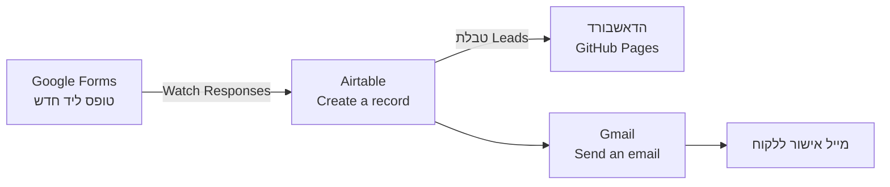

# AUTOMATION.md - אוטומציה: ליד חדש מהטופס נכנס לדאשבורד

## מה האוטומציה עושה

כשמישהו ממלא את הטופס **"ליד חדש - Renovia"** ב-Google Forms, האוטומציה (שנבנתה ב-Make):

1. יוצרת אוטומטית שורה חדשה בטבלת **Leads** ב-Airtable - אותה טבלה שמזינה את הדאשבורד.
2. שולחת ללקוח מייל אישור שהפנייה התקבלה.

הדאשבורד שולף את הנתונים מ-Airtable בכל טעינת דף, ולכן הליד החדש מופיע בו אחרי רענון - בראש טבלת הלידים האחרונים.

## תרשים

## השלבים ב-Make (שלושה מודולים)

| # | מודול | פעולה | מה מוגדר בו |
|---|---|---|---|
| 1 | Google Forms | Watch Responses | מזהה תשובות חדשות בטופס |
| 2 | Airtable | Create a record | בסיס Leads Dashboard, טבלת Leads (פירוט המיפוי בטבלה למטה) |
| 3 | Gmail | Send an email | נמען: האימייל שהלקוח הזין. נושא: "קיבלנו את פנייתך - Renovia" |

### מיפוי השדות מהטופס לטבלה

| עמודה ב-Airtable | מאיפה הערך |
|---|---|
| lead_id | מזהה התשובה (Response ID) של Google Forms |
| name | התשובה לשאלה "שם מלא" |
| source | התשובה לשאלה "מקור" (חייבת להיות אחת מהאפשרויות בטבלה) |
| stage | ערך קבוע: חדש |
| created_date | זמן יצירת התשובה בטופס |
| last_contact_date | זמן יצירת התשובה בטופס |
| deal_value | ערך קבוע: 0 |
| agent | ריק - בדאשבורד מוצג "לא שויך" עד ששמים נציג |

## איך לבדוק

1. למלא את הטופס (שם, מקור, ואימייל לקבלת האישור).
2. ב-Make: להפעיל את התרחיש, או ללחוץ **Run once** אם הוא כבוי.
3. לבדוק שנוספה שורה בטבלת Leads, ושהיא מופיעה בראש הטבלה בדאשבורד אחרי רענון.
4. לבדוק שהגיע מייל אישור לכתובת שהוזנה (כולל בתיקיית הספאם).

## הערות

- **פרטיות:** כתובת האימייל של הלקוח משמשת רק לשליחת מייל האישור ולא נשמרת ב-Airtable ולא מוצגת בדאשבורד - בהתאם ל-SPEC, שלפיו הדאשבורד לא כולל פרטים אישיים של הלקוח.
- **תקינות החיבורים:** החיבור של Make ל-Gmail תקף עד 17 במאי 2027, ואז צריך לאשר אותו מחדש.
- **אין סודות בריפו:** הרשאות החיבור ל-Airtable, ל-Google ול-Gmail שמורות ב-Make, והטוקן של הדאשבורד ב-GitHub Secrets.

## קישורים

- דאשבורד חי: https://tehila84.github.io/leads-dashboard/
- הטופס: https://docs.google.com/forms/d/e/1FAIpQLSfvDbecK-EOFRKgvPPlZ-8X1sY-6785CWPUWYWdsCyLu31krQ/viewform
