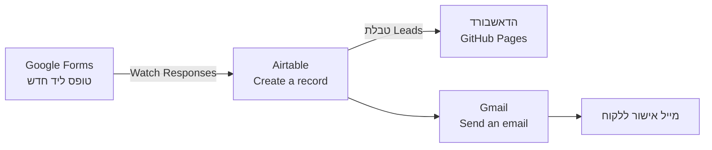

# AUTOMATION.md - אוטומציה: ליד חדש מהטופס נכנס לדאשבורד

## מה האוטומציה עושה

כשמישהו ממלא את הטופס **"ליד חדש - Renovia"** ב-Google Forms, האוטומציה (שנבנתה ב-Make):

1. יוצרת אוטומטית שורה חדשה בטבלת **Leads** ב-Airtable - אותה טבלה שמזינה את הדאשבורד.
2. שולחת ללקוח מייל אישור שהפנייה התקבלה.

הדאשבורד שולף את הנתונים מ-Airtable בכל טעינת דף, ולכן הליד החדש מופיע בו אחרי רענון - בראש טבלת הלידים האחרונים.

## תרשים

## השלבים ב-Make (שלושה מודולים)

| # | מודול | פעולה | מה מוגדר בו |
|---|---|---|---|
| 1 | Google Forms | Watch Responses | מזהה תשובות חדשות בטופס |
| 2 | Airtable | Create a record | בסיס Leads Dashboard, טבלת Leads (פירוט המיפוי בטבלה למטה) |
| 3 | Gmail | Send an email | נמען: האימייל המאומת של המשיב (Respondent Email, מגיע מ-Google). נושא: "קיבלנו את פנייתך - Renovia" |

### מיפוי השדות מהטופס לטבלה

| עמודה ב-Airtable | מאיפה הערך |
|---|---|
| lead_id | מזהה התשובה (Response ID) של Google Forms |
| name | התשובה לשאלה "שם מלא" |
| source | התשובה לשאלה "מקור" (חייבת להיות אחת מהאפשרויות בטבלה) |
| stage | ערך קבוע: חדש |
| created_date | זמן יצירת התשובה בטופס |
| last_contact_date | זמן יצירת התשובה בטופס |
| deal_value | ערך קבוע: 0 |
| agent | ריק - בדאשבורד מוצג "לא שויך" עד ששמים נציג |

## איך לבדוק

1. להיכנס לטופס עם חשבון Google, לסמן את התיבה שמאשרת רישום האימייל, ולמלא שם ומקור.
2. ב-Make: להפעיל את התרחיש, או ללחוץ **Run once** אם הוא כבוי.
3. לבדוק שנוספה שורה בטבלת Leads, ושהיא מופיעה בראש הטבלה בדאשבורד אחרי רענון.
4. לבדוק שהגיע מייל אישור לכתובת של חשבון ה-Google שבו נכנסו לטופס (כולל בתיקיית הספאם).

## הערות

- **אבטחה (תיקון להערת המורה):** בגרסה הראשונה הטופס היה ציבורי ושלח מייל לכל כתובת שהוקלדה בו, כך שמישהו יכול היה להקליד כתובת של אדם אחר ולגרום לשליחת מייל אליו. התיקון: בהגדרות הטופס נבחר "איסוף כתובות אימייל: מאומתות", שדורש כניסה עם חשבון Google. שאלת האימייל הידנית הוסרה, והאוטומציה שולחת רק לכתובת המאומתת של מי שמילא את הטופס. המחיר: לקוחות חייבים חשבון Google.
- **פרטיות:** כתובת האימייל של הלקוח משמשת רק לשליחת מייל האישור ולא נשמרת ב-Airtable ולא מוצגת בדאשבורד - בהתאם ל-SPEC, שלפיו הדאשבורד לא כולל פרטים אישיים של הלקוח.
- **תקינות החיבורים:** החיבור של Make ל-Gmail תקף עד 17 במאי 2027, ואז צריך לאשר אותו מחדש.
- **אין סודות בריפו:** הרשאות החיבור ל-Airtable, ל-Google ול-Gmail שמורות ב-Make, והטוקן של הדאשבורד ב-GitHub Secrets.

## אוטומציה מוכנה שיובאה מ-Make (תרגיל ייבוא)

בנוסף לאוטומציה שבניתי בעצמי, מצאתי אוטומציה שמישהו אחר בנה, ייבאתי אותה לחשבון ה-Make שלי והשתמשתי בה.

- **התבנית:** "Get Telegram messages for new Google Sheets rows", מתוך גלריית התבניות (Templates) של Make. התבנית שנוצרה על ידי אחרים וזמינה לכל המשתמשים.
- **מה היא עושה:** בכל פעם שנוספת שורה חדשה בגיליון Google Sheets, בוט בטלגרם שולח הודעה עם הטקסט שבעמודה B.
- **מודולים:** שניים - Google Sheets (`Watch New Rows`) ואחריו Telegram Bot (`Send a Text Message or a Reply`).
- **הקובץ בריפו:** [blueprints/Get_Telegram_messages_for_new_Google_Sheets_rows.blueprint.json](blueprints/Get_Telegram_messages_for_new_Google_Sheets_rows.blueprint.json) - ה-Blueprint שיוצא מ-Make באמצעות `Export Blueprint`.

### מה הייתי צריכה להתאים אחרי הייבוא

1. ליצור גיליון Google Sheets חדש ("ייבוא אוטומציה") עם הכותרות `שם` ו-`הודעה`, בחשבון Google של החנות.
2. ליצור בוט בטלגרם דרך BotFather ולחבר אותו ל-Make באמצעות הטוקן שלו.
3. להחליף את השדה **Chat ID** (שהתבנית מילאה בערך לא מתאים) במספר הזיהוי של הצ'אט שלי בטלגרם.
4. למפות את השדה **Text** לעמודה B, `הודעה`.

### איך בדקתי

הפעלתי **Run once** והוספתי שורה חדשה בגיליון, והודעה הגיעה אליי לטלגרם. בבדיקה הראשונה התקבלה שגיאה (`Missing value of required parameter 'text'`), כי Make קרא את השורה לפני שהטקסט בעמודה B הוקלד. הפתרון היה להקליד קודם את ההודעה ב-B, ורק אחר כך את השם ב-A.

### הערות

- האוטומציה הזאת לא קשורה לדאשבורד, והיא נועדה לתרגול ייבוא ושימוש בתבנית של מישהו אחר.
- הקובץ לא כולל טוקן או סיסמה. הטוקן של הבוט נשמר רק ב-Make.

## קישורים

- דאשבורד חי: https://tehila84.github.io/leads-dashboard/
- הטופס: https://docs.google.com/forms/d/e/1FAIpQLSfvDbecK-EOFRKgvPPlZ-8X1sY-6785CWPUWYWdsCyLu31krQ/viewform
